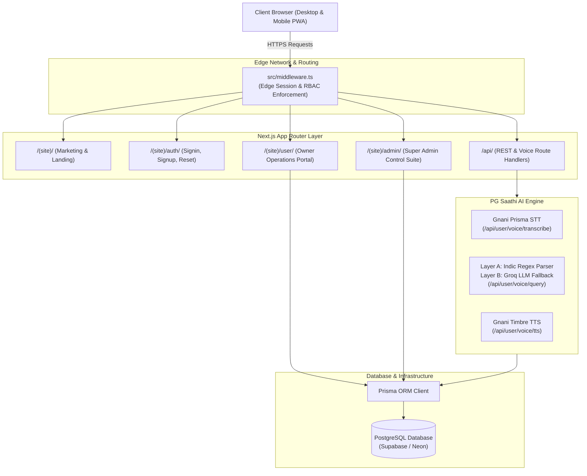
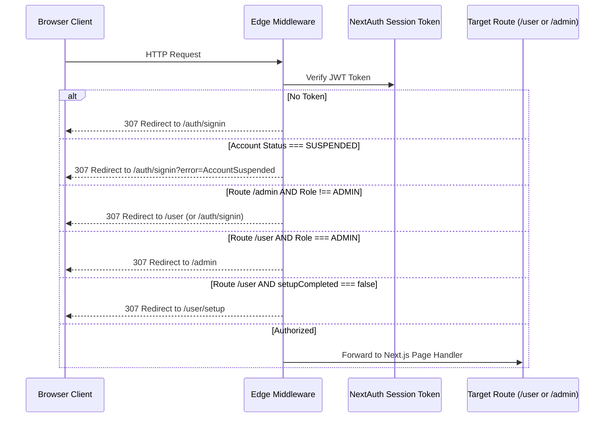
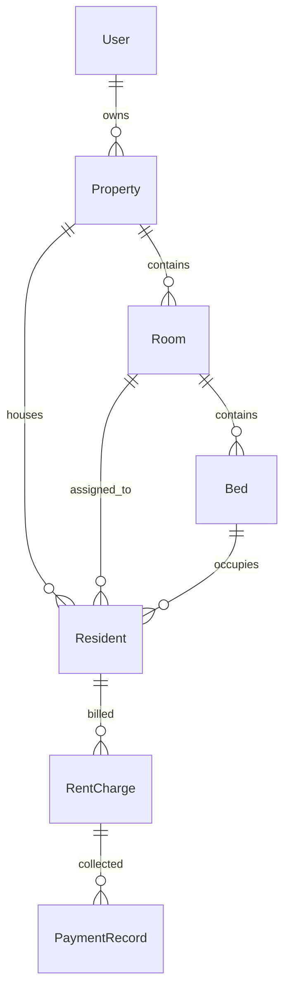

# System Architecture Overview

Choose Bed is a multi-tenant Indian PG and Hostel Management SaaS integrated with **PG Saathi AI** — an Indic voice intelligence assistant for business owners.

This document details the high-level architecture, frontend/backend boundaries, authentication flow, data isolation, and the hybrid voice conversation pipeline.

---

## 🏛️ High-Level System Architecture

Choose Bed is built on **Next.js 15 (App Router)** and **React 19**, deployed with PostgreSQL via **Prisma ORM**.



---

## 🔒 Authentication & Role-Based Access Control (RBAC)

The platform enforces three distinct user roles:

1. **`ADMIN`**:
   - Platform administration and oversight.
   - Access to `/admin` routes: Platform metrics, Owners Directory, Properties audit, Security Audit Trail.
   - Blocked by Edge Middleware from entering owner operational views (`/user`).
2. **`BUSINESS_OWNER`**:
   - PG and hostel operators managing physical properties.
   - Access to `/user` routes: Dashboard, Rooms & Beds, Resident Roster, Rent Ledgers, Account Settings, PG Saathi Voice Assistant.
   - Enforced onboarding: Users with `setupCompleted: false` are locked to `/user/setup` until their first property is configured.
3. **`USER`**:
   - Standard read-only access or residents.

### Middleware Execution Flow



---

## 🏢 Multi-Tenant Data Isolation Model

Choose Bed uses a shared-database, row-level tenant isolation pattern enforced through owner scoping:



### Isolation Invariants:

1. Every business query verifies ownership: `where: { propertyId: { in: ownerPropertyIds } }` or `where: { ownerId: session.user.id }`.
2. Bed allocations use database unique constraints: a bed can hold at most one active resident.
3. Monthly rent charges enforce `@@unique([residentId, billingPeriod])` preventing duplicate billings.
4. Voice assistant queries query only properties belonging to the authenticated `session.user.id`.

---

## 🎙️ PG Saathi AI: 3-Layer Conversation Pipeline

PG Saathi AI is designed for cost efficiency, speed, and reliability. Standard queries bypass LLM inference completely.

```mermaid
flowchart TD
    AudioIn["User Mic Audio / Typed Query"] --> VAD["Client VAD & Silence Detector<br/>(1.4s post-speech auto-stop)"]
    VAD --> STTAPI["POST /api/user/voice/transcribe<br/>(Gnani Prisma STT)"]
    STTAPI --> Normalized["Normalized Query Text<br/>(Indic digits, fillers stripped)"]

    subgraph HybridEngine["Hybrid Intent Resolution"]
        LayerA["Layer A: Deterministic Indic Parser<br/>(RegEx, Indic script, context memory)"]
        LayerB["Layer B: Groq Cloud LLM<br/>(Called only if confidence < 0.75)"]
        Registry["Central Capability Registry<br/>(Validation & Grounding Contract)"]
    end

    Normalized --> LayerA
    LayerA -->|Confidence >= 0.75| LayerC["Layer C: Authoritative Database Query<br/>(Prisma read-only PostgreSQL)"]
    LayerA -->|Ambiguous / Confidence < 0.75| LayerB
    LayerB --> Registry
    Registry --> LayerC

    subgraph Fallback["Safety & Quota Guard"]
        SafeReply["Safe Fallback Response<br/>(Zero hallucinations, clear guidance)"]
    end
    LayerB -.->|Key missing / Timeout / Rate-limit| SafeReply

    LayerC --> SpokenAns["Multilingual Text Response<br/>(Hindi, Hinglish, Gujarati, English)"]
    SpokenAns --> TTSCache{"Audio in<br/>Client Cache?"}
    TTSCache -->|Yes (0 credits)| PlayAudio["Play Audio via Web Audio API"]
    TTSCache -->|No| TTSAPI["POST /api/user/voice/tts<br/>(Gnani Timbre TTS)"]
    TTSAPI --> PlayAudio
```

### Layer Details:

- **Layer A (Deterministic Parser)**:
  - 100% free, 0ms latency, zero token cost.
  - Recognizes Roman Hindi (Hinglish), Devanagari Hindi, Gujarati script, Indic numerals, and English.
  - Handles Room Vacancies, Bed Counts, Rent Inquiries, AC Filters, Resident Dues, and Guidance.
- **Layer B (Groq Cloud LLM)**:
  - Model: `qwen/qwen3.8-27b` (configurable via `GROQ_MODEL`).
  - Active only for ambiguous phrasing or unknown user sentence structures.
  - Returns strictly typed JSON validated against `capabilityRegistry.ts`.
- **Layer C (Database Grounding)**:
  - Queries real PostgreSQL database via Prisma with authenticated owner scoping.
  - Calculates live metrics (`totalRooms`, `roomsWithVacancy`, `availableBeds`).
  - Strict read-only guarantee: zero database mutations allowed via voice.
